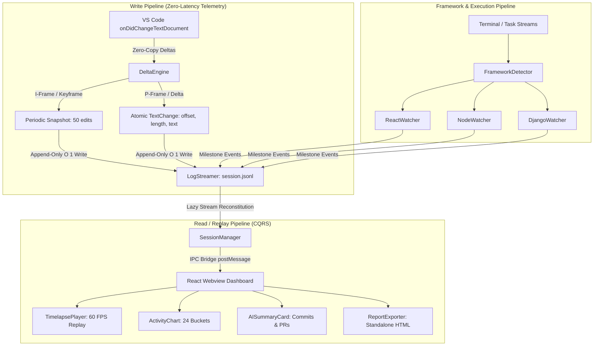

# ⚡ CodeLapse (VS Code Extension)

> **Passive background session recorder, multi-file code timelapse replay player, and AI-driven development analytics for VS Code.**

[](https://www.typescriptlang.org/)
[](https://reactjs.org/)
[](https://code.visualstudio.com/)
[-brightgreen.svg)]()
[]()

---

## 🎬 Quick Showcase: Live Full-Stack Demo Report

We have pre-generated a complete, self-contained standalone demo report showcasing a developer building a **Full-Stack Task Management app (React + Node.js Express + TypeScript)** from scratch to completion.

### How to View the Demo:
1. Double-click or open [`demo_showcase_report.html`](./demo_showcase_report.html) in any web browser (**Google Chrome, Safari, Edge, Firefox**).
2. **Watch the Code Timelapse**:
   - Press **`▶ Play`** or drag the timeline scrubber to watch the code write itself line by line.
   - Watch the active file tabs automatically switch between `server/src/index.ts`, `server/src/types.ts`, `client/src/App.tsx`, and `client/src/components/TaskCard.tsx`.
   - Click the milestone markers on the slider:
     - `✕` / `✓` **Test Run Failures & Fixes**
     - `⚛️` **React / Vite HMR Updates**
     - `🚀` **Node.js Express Server Startup**
     - `📦` **NPM Package Additions**
   - Check the **Top Metrics Row**, the **24-Bucket Activity Distribution**, and the **AI Summarizer (Conventional Commits & PR description)**!

---

## 🚀 Key Features

### 1. 📁 Folder-Scoped Recording
- **You choose what gets recorded**: nothing is recorded until you pick the folder you are working in, either an open workspace folder or any folder via **Browse** (e.g. one assignment inside a course folder). You can also right-click a folder in the Explorer and choose **CodeLapse: Choose Folder to Record**.
- **Only that folder**: edits to files outside it, and inside `.git` or `node_modules`, are ignored. Test/build runs from tasks or debug sessions that belong to another project are ignored too.
- **Clean project paths**: files are stored relative to the chosen folder (`src/App.tsx`), so the replay shows the project's own structure.
- **Remembered per workspace**: reopening VS Code resumes recording the same folder. The status bar always shows which folder is being recorded; switching folders saves the current session and starts a new one.

### 2. 🎥 60 FPS Interactive Timelapse Player
- **Smooth Typing Playback**: Instead of jumping between snapshots, the player diffs each snapshot against the previous version of the file (line-level LCS, trimmed to the exact changed characters) and animates the edit character by character, driven by `requestAnimationFrame`.
- **Skip Idle**: Gaps where nothing was typed are glided across in a fraction of a second, so playback time is spent on actual coding.
- **Scrubbable Timeline**: Time-based slider (the thumb lines up with run and milestone markers), snapshot stepping (`⏮️` / `⏭️`) and variable speeds (`1x`, `2x`, `5x`, `10x`).
- **Keyboard Shortcuts**: `Space` play/pause, `←` / `→` previous/next snapshot, `Home` / `End` jump to start/end.
- **Exact Cursor & Selection Tracking**: Reconstructs typing cursor positions (`|`) and highlighted selection ranges in real-time.
- **Syntax Highlighting**: Embedded PrismJS syntax engine supporting TypeScript, JavaScript, Python, CSS, JSON, HTML, etc.
- **Multi-File Workspace Awareness**: Automatically transitions between files as edits jump across the project.

### 3. 🧭 File Navigation Graph
- **How the work moved between files**: files grouped by top-level folder, with an arrow for every move from one file to another. Thicker arrows were taken more often; arrows in both directions show back-and-forth (e.g. test ↔ implementation).
- **Replays in sync**: the current file is outlined, arrows appear as the replay reaches each move, and a dot travels along the move in progress.
- **Click an arrow** to list every time that move happened; pick one to jump there with the lines typed during that visit highlighted in green, or **Replay this visit**.
- **Read-only visits count**: switching to a file is recorded (with its content on arrival), so opening a file just to read it shows up as its own visit. Glances under 3 seconds are ignored.

### 4. 📊 24-Bucket Activity & Mini-Diff Heatmaps
- Slices the session duration into **24 proportional temporal buckets**.
- **Interactive Mini-Diff Hover**: Hover over any bucket to see the exact time slice, character volume, and a mini-diff preview of lines added (`+`) and removed (`-`).
- **Line Edit Heatmaps**: Algorithmic line diffing that highlights code churn and the most heavily modified lines.

### 5. 🧠 Framework-Specific Intelligence
- **⚛️ React / Next.js / Vite**:
  - Intercepts Vite HMR updates (`[vite] hmr update <file>`) and Next.js Fast Refresh compilation timings.
  - Detects React Hook additions (`useState`, `useEffect`, custom hooks) and catches runtime render errors.
- **🟢 Node.js / Express / NestJS**:
  - Tracks `nodemon`, `tsx watch`, and `node --watch` restart/exit lifecycles.
  - Automatically captures server listening ports (e.g. `http://localhost:5000`) and npm package installations.
- **🐍 Django / Python**:
  - Intercepts `makemigrations` and `migrate` database schema executions (`Applying <app>.<migration>... OK`).
  - Tracks Django `StatReloader` changes and system check passes.

> **Current limitation:** the terminal-output watchers above (HMR, nodemon, server ports, npm installs, migrations) rely on VS Code's *proposed* `terminalDataWriteEvent` API, which installed extensions are not allowed to use. Until they are moved to the stable shell-execution API, these milestones only appear in generated demo data. Test/build runs **are** recorded when launched as VS Code Tasks (**Terminal → Run Task…**) or debug sessions, and React hook usage is detected on save.

### 6. 🤖 AI Session Intelligence & Summarizer
- **Conventional Commit Generator**: Auto-generates structured messages (e.g. `feat(auth): ...` or `fix(jwt): ...`) based on net line counts and test results.
- **Markdown PR Description**: Produces ready-to-copy GitHub Pull Request summaries with modified file tables, test pass rates, and session highlights.
- **Daily Standup Report**: One-click summary formatted for Slack / Microsoft Teams.

### 7. 📥 Standalone Single-File HTML Exporter
- Export your session to a standalone `.html` file that embeds the entire React dashboard, PrismJS highlighter, styles, and replay dataset.
- Shareable with professors, teammates, and recruiters without requiring VS Code installed.

---

## 🏛️ Computer Science Architecture & Design

CodeLapse implements modern, industry-standard systems and software engineering patterns:



### Core CS Paradigms:
1. **Event Sourcing & Delta Compression (\(O(N \cdot L) \to O(\Delta)\))**:
   - Instead of duplicating full file text strings on every keystroke, CodeLapse captures atomic `TextChange` deltas (`rangeOffset`, `rangeLength`, `text`).
   - Uses a **Keyframe (I-Frame)** every 50 edits and lightweight **Deltas (P-Frames)** in between, reducing storage footprint and memory by over **90%**.
2. **Write-Ahead Logging (WAL) & Append-Only Streaming (\(O(1)\) Non-Blocking IO)**:
   - Eliminates `JSON.stringify` event loop freezes by writing single lines to `session-<timestamp>.jsonl` using Node's `fs.createWriteStream`.
3. **CQRS (Command Query Responsibility Segregation)**:
   - Decouples the ultra-lightweight write recorder from the heavy analytics and diffing engine.
4. **Strategy / Plugin Pattern**:
   - `FrameworkDetector` scans project manifests and dynamically attaches active framework watchers without monolithic bloat.

---

## 🛠️ Getting Started & Quickstart

### Prerequisites
- [Node.js](https://nodejs.org/) (v18+ recommended)
- [VS Code](https://code.visualstudio.com/) (v1.85+)

### Installation & Build

```bash
# 1. Clone repository
git clone https://github.com/Shanthan2307/Codelapse_ext.git
cd Codelapse_ext

# 2. Install dependencies
npm install

# 3. Compile extension and React webview bundles
npm run compile

# 4. Run automated test suite
npm test

# 5. Run end-to-end tests inside a real VS Code (opens a VS Code window briefly)
npm run test:integration
```

### Running in VS Code
1. Open the project folder in VS Code.
2. Press **`F5`** (or go to **Run & Debug** and click **"Run CodeLapse Extension"**).
3. An **`[Extension Development Host]`** window will open.
4. In that window, click **`CodeLapse: Choose folder`** in the status bar (or accept the prompt) and pick the folder you will work in. Only files inside it are recorded.
5. Write code, run tests as VS Code Tasks, and use the Command Palette (`Cmd+Shift+P` / `Ctrl+Shift+P`):
   - **`CodeLapse: Choose Folder to Record`**
   - **`CodeLapse: Start Recording Session`**
   - **`CodeLapse: Stop Recording Session`** (opens the report)
   - **`CodeLapse: Show Session Report & Analytics`**
   - **`CodeLapse: Export Standalone HTML Report`**
   - **`CodeLapse: Save Session Data to Folder`** (copies chosen sessions' raw logs plus an HTML report into one folder to share)

---

## 🧪 Test Suite

CodeLapse includes a comprehensive Mocha test suite covering core analytics, delta reconstruction, debouncing, framework watchers, and AI summarization:

```
  SessionSummarizer AI & Standup Intelligence Tests
    ✔ generates structured conventional commits and PR summaries from session data

  AnalyticsEngine Unit Tests
    ✔ accurately computes session duration
    ✔ accurately calculates net lines written across multiple files
    ✔ accurately computes total estimated keystrokes
    ✔ generates a 24-bucket activity array representing the session timeline
    ✔ calculates line edit heatmaps with accurate edit counts and intensity
    ✔ produces comprehensive session analytics summary

  DeltaEngine Keyframe & Delta Patching Tests
    ✔ applies simple atomic insertions and deletions correctly
    ✔ reconstructs file text accurately from a Keyframe + Delta sequence
    ✔ folds a live delta stream onto per-file baselines, not onto empty text
    ✔ materializes multi-file DeltaSnapshots into chronological full Snapshots

  DocumentTracker Debounce & Milestone Tests
    ✔ batches rapid keystrokes within 500ms into a single snapshot (82ms)
    ✔ independently tracks debouncing across distinct multi-file paths (61ms)
    ✔ triggers a large-delete SessionEvent when more than 50 characters are deleted (62ms)

  Framework Watchers Unit Tests
    ✔ ReactWatcher intercepts Vite and Next.js HMR compilation events
    ✔ NodeWatcher intercepts Nodemon restarts, package additions, and server ports
    ✔ DjangoWatcher intercepts migrations, system checks, and StatReloader reloads

  PlaybackModel Smooth Typing Interpolation Tests
    ✔ reproduces the target text exactly once all edits are applied
    ✔ survives randomized edit sequences (fuzz)
    ✔ only retypes the changed parts when two distant lines are edited
    ✔ never glues following code onto a line that is still being typed
    ✔ places the caret at the end of the text typed so far
    ✔ shows exact snapshots at their timestamps and typing in between
    ✔ keeps typing windows inside the gap before each snapshot
    ✔ reports idle spans so the player can skip them
    ✔ steps between snapshot boundaries

  Folder-Scoped Recording Path Tests
    ✔ accepts the folder itself and anything beneath it
    ✔ rejects parents, siblings, and look-alike sibling names
    ✔ honours case-insensitive file systems only when asked to
    ✔ detects overlapping folders in both directions
    ✔ produces forward-slash paths relative to the chosen folder
    ✔ ignores files inside .git and node_modules

  Standalone HTML Report Embedding Tests
    ✔ never lets recorded code close the surrounding <script> tag
    ✔ escapes HTML special characters in titles

  FileFlowModel Navigation Graph Tests
    ✔ turns edits into visits, and visits into moves and edges (with back-and-forth)
    ✔ ignores flicking through a tab, but keeps a real read-only visit
    ✔ highlights exactly the lines typed during a visit
    ✔ does not count existing content as typing when the file was first seen on arrival
    ✔ treats a brand-new file typed from scratch as all typed
    ✔ does not highlight the line above when Enter starts a new line

  FileFlowModel alignment with the replay
    ✔ starts each visit when its typing starts appearing on screen

  41 passing (230ms)
```

End-to-end tests (`npm run test:integration`) launch a real VS Code with a throwaway profile and a two-project workspace, make real edits, and verify what lands on disk:

```
  Folder-scoped recording (real VS Code)
    ✔ records nothing until a folder is chosen
    ✔ records only files inside the chosen folder, with folder-relative paths
    ✔ starts every new session with a keyframe so it replays from disk
    ✔ switching folders saves the old session and records only the new folder
    ✔ records moves between files, including files that were only read
    ✔ never writes absolute paths (or the username in them) into recordings
    ✔ saves chosen sessions as raw logs plus a working HTML report

  7 passing (15s)
```

---

## 📁 Repository Structure

```
codelapse_ext/
├── src/
│   ├── ai/
│   │   └── SessionSummarizer.ts       # AI Conventional Commit & PR Generator
│   ├── analytics/
│   │   └── engine.ts                  # 24-Bucket Timeline, Heatmap & Session Metrics
│   ├── events/
│   │   └── EventMonitor.ts            # Task & Debug execution & Idle timer monitor
│   ├── export/
│   │   └── ReportExporter.ts          # Standalone Single-File HTML Bundler
│   ├── frameworks/
│   │   ├── types.ts                   # Framework Watcher Interfaces
│   │   ├── FrameworkDetector.ts       # Dynamic Workspace Manifest Scanner
│   │   ├── ReactWatcher.ts            # React / Next.js / Vite HMR & Hook Watcher
│   │   ├── NodeWatcher.ts             # Node.js / Nodemon & Package Watcher
│   │   └── DjangoWatcher.ts           # Django Migrations & StatReloader Watcher
│   ├── storage/
│   │   └── LogStreamer.ts             # Append-Only JSONL Write-Ahead Logger
│   ├── tracker/
│   │   ├── DeltaEngine.ts             # Keyframe (I-Frame) & Delta (P-Frame) Compression
│   │   ├── DocumentTracker.ts         # VS Code Text & Selection Event Ingestion
│   │   ├── RecordingScope.ts          # Chosen Folder: Picker, Persistence & File Filtering
│   │   ├── folderScope.ts             # Pure Path Containment & Relative-Path Helpers
│   │   └── SessionManager.ts          # Local Persistence & Session Lifecycle Manager
│   ├── ui/
│   │   ├── flow/
│   │   │   └── FileFlowModel.ts       # Visits, Moves & Edges for the File Navigation Graph
│   │   ├── playback/
│   │   │   └── PlaybackModel.ts       # Diff-Based Typing Interpolation & Playback Timeline
│   │   ├── App.tsx                    # Main React Dashboard Shell
│   │   ├── styles.css                 # Theme-Native VS Code Design System
│   │   └── components/
│   │       ├── AISummaryCard.tsx      # AI Commit & Standup Tabbed UI
│   │       ├── ActivityChart.tsx      # 24-Bucket Keystroke Timeline Bar Chart
│   │       ├── ActivityTooltip.tsx    # Interactive Mini-Diff Hover Popover
│   │       ├── MetricsRow.tsx         # Duration, Keystroke, Net Lines & Run Stats
│   │       └── TimelapsePlayer.tsx    # 60 FPS Code Video Replay with Cursor Tracking
│   ├── webview/
│   │   ├── ReportPanel.ts             # VS Code Webview Panel Singleton & IPC Bridge
│   │   └── index.tsx                  # Webview React 18 Entrypoint
│   ├── extension.ts                   # VS Code Extension Host Entrypoint & Commands
│   └── models.ts                      # Core Data Models & Telemetry Schemas
├── scripts/
│   └── generate_showcase_session.ts   # Full-Stack Showcase Generator
├── demo_showcase_report.html          # Standalone Interactive HTML Showcase Demo
├── package.json                       # Extension Manifest & Dependencies
├── tsconfig.json                      # Strict TypeScript Configuration
└── webpack.config.js                  # Dual-Target (Node + Webview) Webpack Bundler
```

---

## 📜 License
MIT © Shanthan & CodeLapse Contributors
